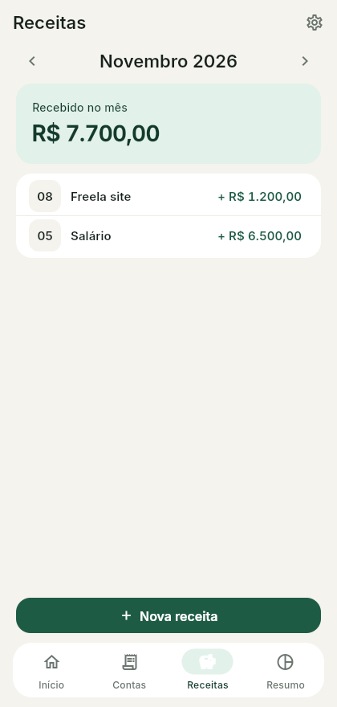

<p align="center">
  
</p>

<h1 align="center">Quitado</h1>

<p align="center">
  Controle simples de contas a pagar — sem conta, sem nuvem, sem anúncio.
</p>

<p align="center">
  <a href="https://github.com/Langendolff/quitado/releases/latest"></a>
  
  
</p>

<p align="center">
  
  
  
  
</p>

## Funcionalidades

- **Saldo acumulado:** tudo que entrou menos tudo que foi pago, sempre à vista na tela inicial.
- **Contas recorrentes e parceladas:** ao pagar uma conta mensal, a próxima já é criada; parcelas podem ter valores diferentes.
- **Lembretes:** notificação no Android antes do vencimento (o número de dias é configurável); no Linux, um aviso ao abrir o app.
- **Pagar em lote ou só uma parte:** segure para selecionar várias contas, ou pague um valor parcial e o restante continua em aberto.
- **Desfazer pagamento:** toque em uma conta paga no Resumo para reabri-la.
- **Resumo do mês:** recebido, pago, quanto sobrou e quanto ainda falta pagar.
- **Backup:** exporte e restaure todos os dados num arquivo JSON.
- **Privado:** os dados ficam só no aparelho (SQLite). Nenhum acesso à internet.

## Instalação

Baixe o arquivo da [última versão](https://github.com/Langendolff/quitado/releases/latest):

| Plataforma | Arquivo | Como instalar |
|---|---|---|
| Android | `quitado-<versão>.apk` | Abra o APK no celular e permita a instalação de fontes desconhecidas. |
| Linux (x64) | `quitado-<versão>-linux-x64.tar.gz` | Extraia e execute `quitado/contas`. |

## Compilando

Requer o [Flutter](https://docs.flutter.dev/get-started/install) 3.44 ou mais recente.

```sh
flutter pub get
flutter test               # testes
flutter run                # roda no aparelho conectado ou no desktop
flutter build apk          # gera o APK de release
flutter build linux        # gera o binário Linux
```

## Estrutura

```
lib/
  main.dart        # tema, navegação e inicialização
  db.dart          # SQLite: esquema, migrações, pagamentos e backup
  logica.dart      # regras puras (situação da conta, datas, valores)
  lembretes.dart   # notificações agendadas
  telas/           # Início, Contas, Receitas, Resumo e Configurações
test/              # testes da lógica e do banco
```
